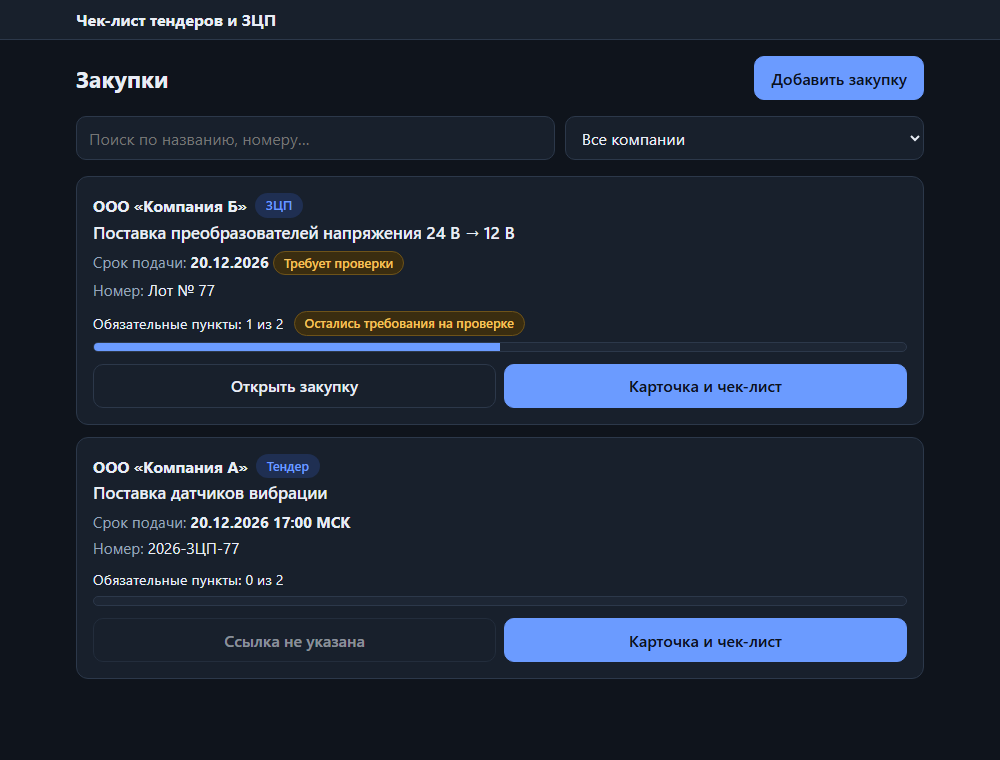
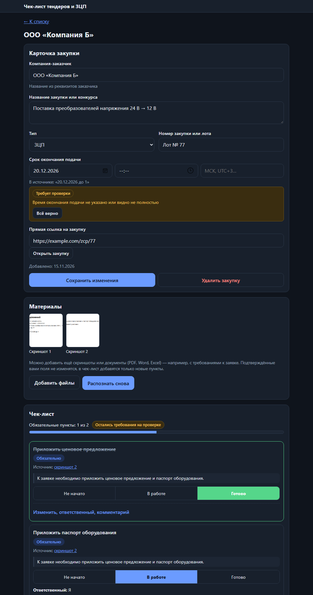
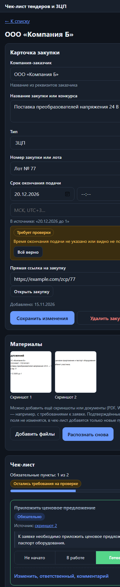

# Чек-лист тендеров и ЗЦП

Личное веб-приложение для подготовки заявок на поставку оборудования. Вставляете ссылку на закупку или загружаете скриншоты документации — приложение заполняет черновик карточки и составляет чек-лист требований. Вы проверяете, правите, сохраняете и отмечаете пункты «Готово».

Приложение рассчитано на одного пользователя: **входа и учётных записей нет**. Всё работает на вашем компьютере, ключи и интернет-сервисы для распознавания не нужны — скриншоты читает локальная модель **Ollama**.

## Как выглядит

Скриншоты сделаны на реальных данных: пример из задания (ЗЦП «Компании Б», два скриншота), распознанный локальной моделью.





На телефоне (ширина 390 px, без горизонтальной прокрутки):



## Промпты

<details>
<summary><b>Первый промпт — ТЗ (как было задано в начале)</b></summary>

```text
1. Задача
Сделай веб-приложение «Чек-лист тендеров и ЗЦП» для подготовки заявок на поставку оборудования. Пользователь вставляет ссылку на конкретную закупку или загружает скриншоты документации. Приложение автоматически заполняет черновик карточки и составляет чек-лист по требованиям закупки. Пользователь проверяет результат, при необходимости исправляет его и сохраняет карточку.
2. Контекст
Я занимаюсь поставками оборудования и участвую в закупках разных компаний. Перед подачей заявки мне нужно сверить оборудование с технической спецификацией, подготовить ценовое предложение, собрать документы и подтвердить срок поставки. Список требований зависит от конкретной закупки.
Я и коллеги будем пользоваться приложением со своих аккаунтов на компьютере и телефоне. Участник видит и редактирует свои карточки. Я как администратор могу приглашать коллег, видеть все закупки команды и проверять, кто добавил каждую карточку. Данные хранятся в общей базе и доступны после входа с другого устройства.
3. Формат
Сделай интерфейс на русском языке. На телефоне карточки и чек-листы должны читаться без горизонтальной прокрутки.

* Добавление закупки. Кнопка «Добавить закупку» открывает форму с полем для ссылки и загрузкой одного или нескольких скриншотов. Можно использовать оба источника для одной карточки. По кнопке «Распознать» приложение читает доступные материалы и заполняет черновик.
* Карточка закупки. Сохраняй название компании-заказчика, название закупки или конкурса, тип («Тендер» или «ЗЦП»), номер закупки или лота, дату и время окончания подачи, прямую ссылку на конкретную закупку и автора карточки. Название компании бери из реквизитов заказчика. Сохраняй введённую ссылку, даже если страницу открыть не удалось. Если добавлены только скриншоты, дай возможность указать ссылку позже.
* Проверка распознанных данных. Если поле отсутствует, плохо читается или источники расходятся, помечай его «Требует проверки». Если в сроке подачи видна только дата или часть времени, тоже помечай его для проверки. Часовой пояс сохраняй, если он указан в источнике.
* Чек-лист. Извлекай из материалов требования к документам и действиям перед подачей заявки. Для каждого пункта показывай название, обязательность, источник и короткую выдержку, по которой пункт был создан. Если обязательность неясна, ставь «Требует проверки». Пользователь может добавить, исправить или удалить пункт, указать ответственного и комментарий, выбрать статус «Не начато», «В работе» или «Готово».
* Недоступные материалы. Если ссылка требует входа или страница не открывается, сообщи об этом и предложи загрузить скриншоты. Если на скриншотах видна только карточка закупки, заполни найденные поля и попроси добавить страницы с требованиями.
* Список закупок. Показывай компанию-заказчика, название, тип, срок подачи и прогресс по обязательным пунктам. Добавь фильтр по компании и кнопку «Открыть закупку», которая ведёт на сохранённую страницу конкурса. Администратор также видит автора и может отфильтровать карточки по нему. Если в чек-листе остались пункты с неясной обязательностью, покажи «Остались требования на проверке».
* Запуск. Подключи рабочее распознавание скриншотов и извлечение текста из доступных страниц. Храни ключи распознавания на сервере. Опиши, как запустить приложение, настроить базу и распознавание, создать аккаунт администратора и открыть приложение с телефона.

4. Пример
Коллега добавляет ссылку на тендер компании «Компания А» по поставке датчиков вибрации. Приложение сохраняет название заказчика и прямую ссылку на тендер.
Я добавляю два скриншота ЗЦП компании «Компания Б» по поставке преобразователей напряжения 24 В → 12 В. На первом видны заказчик, название закупки и номер лота. На втором указано, что к заявке нужно приложить ценовое предложение и паспорт оборудования. Приложение создаёт два обязательных пункта и указывает второй скриншот как источник. Если срок подачи обрезан, приложение помечает его «Требует проверки». Прямую ссылку на ЗЦП я могу добавить позже.
5. Готово, когда

1. По доступной ссылке на тендер приложение создаёт черновик с найденными данными, а по скриншотам ЗЦП заполняет карточку и создаёт два обязательных пункта из примера.
2. Если страница не открывается, введённая ссылка сохраняется, а распознавание можно продолжить по скриншотам.
3. Я вижу в списке закупки от двух компаний, фильтрую их по заказчику и открываю нужный конкурс по сохранённой ссылке.
4. Я могу исправить черновик, сохранить карточку и отметить пункт как «Готово». Прогресс сразу обновляется.
5. Коллега добавляет закупку с телефона, а я вижу её с компьютера под аккаунтом администратора и могу найти её по имени автора.
```

</details>

<details>
<summary><b>Финальный промпт — ТЗ после всех правок (по нему инструмент можно воссоздать с нуля)</b></summary>

```text
Сделай личное веб-приложение «Чек-лист тендеров и ЗЦП» для подготовки заявок на поставку оборудования.

Кто пользуется. Только я. Входа, учётных записей, ролей и приглашений нет. Всё работает на моём компьютере, без облачных сервисов и без ключей API. Данные лежат в локальной базе (SQLite) и папке с загруженными файлами.

Источники закупки. Ссылка, один или несколько скриншотов, документы PDF / Word (.docx, .doc) / Excel (.xlsx) — в любом сочетании для одной карточки. Кнопка «Распознать» читает всё доступное локальной моделью Ollama (qwen2.5vl:7b) и заполняет черновик карточки и чек-лист. Я проверяю, правлю, сохраняю.

Карточка. Компания-заказчик (из реквизитов заказчика, не название торговой площадки), название закупки, тип («Тендер» или «ЗЦП»), номер закупки или лота, дата и время окончания подачи, часовой пояс (если указан в источнике), прямая ссылка. Введённую ссылку сохраняй всегда, даже если страница не открылась. Если есть только скриншоты или документы — ссылку можно добавить позже.

Проверка. Поле отсутствует, плохо читается, источники расходятся, в сроке только дата или часть времени — помечай «Требует проверки» с причиной и кнопкой «Всё верно». Исходную строку срока показывай рядом.

Чек-лист. Требования к документам и действиям перед подачей заявки. У каждого пункта: название, обязательность («Обязательно» / «Не обязательно» / «Требует проверки»), источник («скриншот 2», «документ Извещение.pdf», «страница по ссылке») и короткая выдержка, по которой пункт создан. Пункты можно добавлять, править, удалять; ответственный, комментарий, статус «Не начато» / «В работе» / «Готово». Прогресс по обязательным пунктам обновляется сразу.

Недоступные материалы. Ссылка требует входа, не открылась или страница пустая — скажи об этом, сохрани ссылку и предложи загрузить скриншоты или документы. Если видна только карточка закупки — заполни найденное и попроси добавить страницы с требованиями. PDF-скан без текста, повреждённый файл и неподдерживаемый формат (.xls) — понятная ошибка, ничего не сохраняется.

Список закупок. Компания, название, тип, срок, прогресс по обязательным пунктам; фильтр по компании и поиск; кнопка «Открыть закупку» ведёт на сохранённую ссылку; если остались пункты с неясной обязательностью — «Остались требования на проверке».

Правила качества распознавания (выучено на практике):
- каждый скриншот и каждый фрагмент текста читается отдельным запросом, источник пункта известен точно;
- расхождения между источниками ищи только между страницами с реквизитами закупки; страница «только с требованиями» не должна создавать ложных конфликтов (заголовок раздела — не название закупки);
- пункт чек-листа — только если его цитата выражает требование («необходимо приложить…»); из дубликатов остаётся пункт с убедительной цитатой; пункт без такой цитаты или с цитатой, которой нет в тексте источника, получает «Требует проверки»;
- повторное распознавание не затирает то, что я уже подтвердил: заполняются только пустые и помеченные поля, добавляются только новые пункты.

Защита без входа. Сервер слушает только 127.0.0.1; запросы с чужим именем хоста и с чужих сайтов отклоняются; при загрузке страницы по ссылке не ходить на локальные и внутренние адреса; всё из распознавания выводить как текст, не как HTML; в ссылках только http(s).

Интерфейс на русском. На телефоне без горизонтальной прокрутки.

Запуск. Опиши в README: установку Node.js и Ollama, `ollama pull qwen2.5vl:7b`, запуск (`npm.cmd start` в Windows PowerShell), где лежит база, как открыть с телефона (осознанно, с предупреждением о том, что входа нет).

Готово, когда: пример с двумя скриншотами ЗЦП даёт карточку с названием, номером лота, помеченным обрезанным сроком и ровно двумя обязательными пунктами с источником «скриншот 2»; недоступная ссылка сохраняется, а распознавание продолжается по файлам; в списке видны закупки двух компаний, работает фильтр и «Открыть закупку»; правка, сохранение и статус «Готово» сразу меняют прогресс; PDF, Word и Excel читаются так же, как скриншоты.
```

</details>

## Журнал улучшений: что не так → как должно быть → зачем

Две новые правки — по результатам пробного прогона на реальной модели (пример из задания, два скриншота):

**1. Ложное «расхождение» в названии закупки**
- **Что не так.** По скриншоту «Требования к заявке» модель вернула заголовок раздела как название закупки, и приложение пометило название «В источниках разные значения».
- **Как должно быть.** Расхождения ищутся только между страницами с реквизитами закупки (минимум два из: заказчик, название, номер, дата). Значение со страницы без реквизитов берётся только если других нет — и тогда помечается «проверьте».
- **Зачем.** Ложная пометка заставляет перепроверять верное и подрывает доверие к пометкам, а они — главный способ поймать настоящие ошибки распознавания.

**2. Выдуманный пункт чек-листа с неверным источником**
- **Что не так.** По скриншоту карточки модель создала пункт «Приложить ценовое предложение», взяв «основание» из заголовка страницы «Запрос ценовых предложений». Этот пункт вытеснил настоящий (со скриншота 2), и источником значился скриншот 1.
- **Как должно быть.** Пункт создаётся, только если его цитата выражает требование («необходимо приложить…»). Из одинаковых пунктов остаётся тот, у которого цитата убедительнее; пункт без такой цитаты получает «Требует проверки». В подсказку модели добавлено: заголовки и вид закупки требованиями не являются.
- **Зачем.** Чек-лист — это то, по чему готовят заявку: ложный пункт и неверный источник хуже пропуска, ведь человек потратит время зря или не заметит настоящее требование.

Результат после правок (тот же пример, реальная модель): названия без ложной пометки, срок «20.12.2026 до 1» помечен «Требует проверки», ровно два обязательных пункта с источником «скриншот 2». Покрыто автотестом на реальных ответах модели.

Ранее, по вашим указаниям:
- **Убрать вход и ключ API.** *Что не так:* приложение требовало аккаунты и платный ключ. *Как должно быть:* один пользователь, без входа, распознавание локальной моделью Ollama; защита — доступ только с этого компьютера. *Зачем:* инструмент личный, ключ и учётки — лишняя сложность и расходы.
- **Документы PDF / Word / Excel.** *Что не так:* информацию из извещений и таблиц приходилось пересказывать скриншотами. *Как должно быть:* такие файлы загружаются как источник, текст читается на сервере, у пункта указан документ-источник. *Зачем:* закупочная документация почти всегда приходит файлами.

## Что мешает в работе (список улучшений на субботу)

Наблюдалось при прогонах на реальной модели (скриншоты, PDF, пример из задания):

1. **Нет индикации хода.** Во время распознавания одна крутилка «Распознаём…». При нескольких файлах неясно, сколько осталось. Нужно «обработано 2 из 5».
2. **Распознавание нельзя отменить.** Если загрузил не те файлы, остаётся ждать.
3. **Необязательные требования пропадают.** В PDF-извещении строка «Свидетельство о поверке предоставляется по желанию участника» в чек-лист не попала (модель вернула 2 пункта из 3). Должен быть пункт «Не обязательно».
4. **Первый запрос долгий.** После запуска Ollama первый PDF обработался за 68 с (загрузка модели 6 ГБ в память), дальше около 20 с на скриншот.
5. **Длинные документы читаются не целиком.** Берутся первые 10 фрагментов (~60 тыс. знаков); требования в конце потеряются. Нужно выбирать фрагменты по ключевым словам («требования», «заявка», «документы»).
6. **Цитаты со скриншотов не проверяются.** Для текста проверяем, что цитата есть в источнике; для картинок остаётся эвристика по формулировке.
7. **Не проверено:** старый `.doc` на настоящем файле, ссылки на реальные торговые площадки (многие требуют входа или грузятся скриптами). Не поддерживается: `.xls`, PDF-сканы (нет OCR).
8. **Запуск в Windows PowerShell:** `npm start` блокируется политикой выполнения скриптов, работает `npm.cmd start`.

*Место для ваших наблюдений после собственной пробы:*
- _(допишите здесь)_

## Что нужно

- **Node.js 22.13 или новее** (рекомендуется 24 LTS) — https://nodejs.org. База данных (SQLite) встроена в Node.
- **Ollama** — https://ollama.com (для распознавания). Видеокарта желательна: на RTX 4060 (8 ГБ) модель из примера работает заметно быстрее, чем на процессоре.

## Запуск

```bash
npm install
npm start
```

Откройте http://localhost:3000.

В Windows PowerShell `npm` может быть заблокирован политикой выполнения скриптов («выполнение сценариев отключено»). Тогда запускайте `npm.cmd start` (и `npm.cmd install`) — настройки системы менять не нужно.

### Распознавание (один раз настроить)

1. Установите Ollama и убедитесь, что она запущена (значок в трее).
2. Скачайте модель (около 6 ГБ):
   ```bash
   ollama pull qwen2.5vl:7b
   ```
3. Обновите страницу «Новая закупка» — предупреждение о недоступном распознавании исчезнет.

Другая модель: переменная `OLLAMA_MODEL` в `.env` (например, `qwen2.5vl:3b` — легче и быстрее, но менее точная). Адрес Ollama — `OLLAMA_URL`.

## Документы: PDF, Word, Excel

К закупке можно загрузить файлы с информацией о ней — вместе со скриншотами и/или ссылкой:

| Формат | Что читается |
|---|---|
| **PDF** (`.pdf`) | Текст всех страниц. PDF-сканы (картинки без текста) не читаются — загрузите страницы как скриншоты |
| **Word** (`.docx`, `.doc`) | Абзацы и таблицы (ячейки одной строкой через « \| ») |
| **Excel** (`.xlsx`) | Все листы построчно: ячейки строки через « \| ». Старый формат `.xls` не поддерживается — пересохраните как `.xlsx` |

До 10 документов на закупку, каждый до 20 МБ; за один раз можно выбрать до 10 файлов. Тип файла проверяется по содержимому, а не по расширению. Нечитаемый, повреждённый или защищённый паролем файл отклоняется с понятным сообщением, и ничего не сохраняется. Документы можно скачать обратно из карточки закупки.

Из документа заполняются те же поля карточки и чек-лист. Для каждого пункта указан источник («документ „Извещение.pdf“») и выдержка. Ссылка на PDF-файл тоже читается (до 6 МБ). Очень длинные документы читаются по частям: по умолчанию первые 10 фрагментов по ~6000 знаков (`OLLAMA_MAX_CHUNKS` в `.env`); если документ длиннее, вы увидите предупреждение.

## Как работает распознавание

- **Скриншоты.** Каждый скриншот читается отдельным запросом к модели, поэтому для каждого пункта чек-листа точно известен источник («скриншот 2») и сохраняется короткая выдержка. Фото с телефона уменьшаются в браузере перед отправкой.
- **Ссылка и документы.** Приложение берёт текст страницы или документа, делит на фрагменты и читает моделью. Цитата, которой нет в тексте источника, не считается подтверждением: такой пункт получает «Требует проверки».
- **Несколько источников.** Можно дать любое сочетание ссылки, скриншотов и документов. Если в источниках разные значения, поле помечается «Требует проверки» с указанием расхождения.
- **Время.** Распознавание идёт на вашем компьютере и может занимать от десятков секунд до нескольких минут на скриншот — зависит от видеокарты.

| Ситуация | Что происходит |
|---|---|
| Ссылка требует входа / не открывается / страница пустая (грузится скриптами) | Ссылка **сохраняется**, показывается причина и предложение загрузить скриншоты. Распознавание продолжается по ним |
| На скриншотах только карточка закупки | Найденные поля заполняются, появляется просьба добавить страницы с требованиями |
| Поле не найдено, плохо читается, источники расходятся | Поле помечается «Требует проверки» с причиной; кнопка «Всё верно» снимает пометку |
| Виден только день или часть времени в сроке подачи | Срок помечается «Требует проверки», исходная строка показывается рядом («В источнике: …») |
| Обязательность пункта неясна | Пункт помечается «Требует проверки», есть кнопки «Обязательно» / «Не обязательно»; в списке закупок — «Остались требования на проверке» |
| Ollama не запущена или модель не скачана | Показывается, что именно сделать. Черновик с введённой ссылкой и файлами всё равно создаётся; карточку можно заполнить вручную |

«Распознать снова» (после добавления скриншотов) не затирает то, что вы уже подтвердили: заполняются только пустые и помеченные поля, а в чек-лист добавляются только новые пункты.

**Важно.** Локальная модель чаще ошибается, чем большие облачные модели: считайте результат черновиком и проверяйте. Приложение не входит в аккаунты на площадках и не открывает вложенные файлы по ссылкам на странице — скачайте их и загрузите как документы.

## Данные

Всё лежит в папке `data/` (меняется через `DATA_DIR`): `tenders.db` (база SQLite) и `uploads/` (скриншоты и документы). Для резервной копии закройте приложение и скопируйте папку целиком. База, созданная прежней версией приложения, обновляется автоматически при запуске.

## Безопасность без входа

Раз входа нет, защита — в том, что приложение доступно только вам:

- по умолчанию сервер слушает только `127.0.0.1`, то есть открывается лишь с этого компьютера;
- запросы с чужим именем хоста (атака DNS rebinding) и с чужих сайтов отклоняются;
- скачивая страницу по ссылке, приложение не ходит на локальные и внутренние адреса;
- данные из распознавания выводятся как текст, не как HTML; в ссылках разрешены только `http(s)`.

**Открыть с телефона.** Это сделает приложение доступным всем в вашей сети. Если всё же нужно: в `.env` задайте `HOST=0.0.0.0` и `ALLOWED_HOSTS=192.168.1.25` (адрес компьютера из `ipconfig`), разрешите порт в брандмауэре Windows и откройте `http://192.168.1.25:3000` на телефоне в той же Wi-Fi. Делайте это только в доверенной сети. В интернет приложение без входа выставлять нельзя.

## Разработка

```bash
npm test        # автотесты: распознавание (с подставной моделью), документы, чтение ссылок, чек-лист, защита, миграция базы
npm run demo    # интерфейс на http://localhost:3100 с ФИКТИВНЫМ распознаванием, без Ollama
```

Структура: `server/` — API (Express), `server/ollama.js` — работа с моделью, `server/extract.js` — схема ответа, подсказка и разбор, `server/fetchPage.js` — чтение страниц, `public/` — интерфейс без сборки.

---

## Какое указание сильнее всего изменило инструмент

Сильнее всего инструмент изменило указание добавить загрузку PDF, Word и Excel. До него приложение принимало только ссылки и скриншоты. Указание добавить PDF, Word и Excel сильнее всего приблизило инструмент к реальной работе, потому что закупочная документация приходит именно файлами, а не скриншотами. После него текст берётся из файла напрямую, таблицы сохраняются построчно, а у каждого пункта чек-листа указан документ-источник и цитата. Проверять результат по-прежнему нужно мне, поэтому пометки «Требует проверки» остались.
